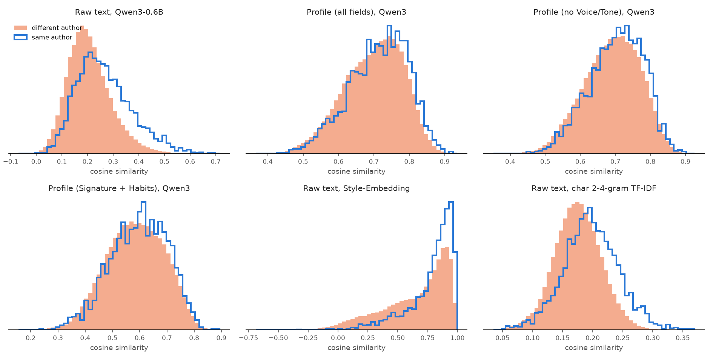

# Writing: same- vs different-author similarity

540 author-labelled snippets, 62 authors; 2355 same-author and 143139 different-author pairs (583 same-source-post pairs dropped). AUC = P(same-author pair scores higher than a different-author pair); 0.5 = no author signal.

| representation | mean cos same | mean cos diff | gap | AUC |
|---|---|---|---|---|
| Raw text, Qwen3-0.6B | 0.265 | 0.207 | +0.058 | 0.663 |
| Profile (all fields), Qwen3 | 0.713 | 0.699 | +0.014 | 0.550 |
| Profile (no Voice/Tone), Qwen3 | 0.703 | 0.690 | +0.013 | 0.546 |
| Profile (Signature + Habits), Qwen3 | 0.597 | 0.584 | +0.013 | 0.538 |
| Raw text, Style-Embedding | 0.786 | 0.654 | +0.132 | 0.654 |
| Raw text, char 2-4-gram TF-IDF | 0.197 | 0.175 | +0.022 | 0.645 |

